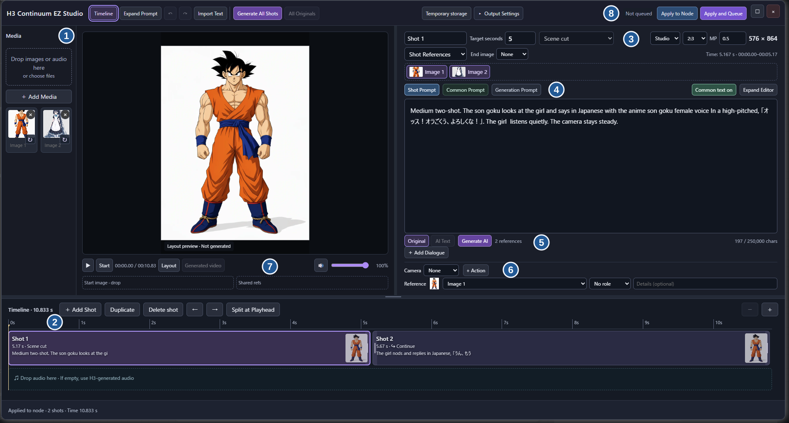

[日本語](README_JA.md) · [v0.13.4 release](https://github.com/ukr8b3g-cmyk/ComfyUI-H3-Continuum-EZ/releases/tag/v0.13.4) · [ZIP](https://github.com/ukr8b3g-cmyk/ComfyUI-H3-Continuum-EZ/releases/download/v0.13.4/ComfyUI-H3-Continuum-EZ-v0.13.4.zip) · [Workflow templates](examples)

# H3 Continuum EZ Studio

An interactive ComfyUI timeline powered by the [H3 Continuum](https://github.com/ukr8b3g-cmyk/ComfyUI-H3-Continuum) continuation engine. Arrange media, edit each shot, and export a video with audio. The engine splits long shots into internal parts and carries the scene across them.

## Get started

1. Extract the [release ZIP](https://github.com/ukr8b3g-cmyk/ComfyUI-H3-Continuum-EZ/releases/download/v0.13.4/ComfyUI-H3-Continuum-EZ-v0.13.4.zip) and place `ComfyUI-H3-Continuum-EZ` in `ComfyUI/custom_nodes/`. For a Git install, run `git clone https://github.com/ukr8b3g-cmyk/ComfyUI-H3-Continuum-EZ.git` from `custom_nodes`. Update a Git install with `git pull --ff-only`. Restart ComfyUI and refresh the browser after installing or updating.
2. Drag the repository's [H3_Continuum_EZ_Studio.json](examples/H3_Continuum_EZ_Studio.json) into ComfyUI.
3. Install the models below and check their file selections on the subgraph. Open **Timeline Studio** on the H3 Continuum EZ Timeline node. The template starts with a 10-second singing shot at 1:1 and 0.5 MP. For an image reference, add your own image or ComfyUI's `example.png` if available.

## Studio walkthrough

| No. | What to do |
| --- | --- |
| ① Media | Use **Add Media** or drop images and audio into the library. Reuse an image by adding it to the selected shot's references. User-provided media in this screenshot is an example. |
| ② Timeline and audio | Select, add, duplicate, delete, reorder or split shots. Drag a shot edge to change its duration. Drag audio from the library to the lower track, then select a clip to edit or delete that placement. |
| ③ Shot, references and size | Set **Target seconds** and **Scene cut / Continue** for the selected shot. Choose shared or shot references, click the images to use, and optionally choose an **End image**. Aspect ratio and MP set the output size for the whole video. **Time** shows H3-aligned duration. |
| ④ Prompts | Edit the selected scene in **Shot Prompt**, or reusable details in **Common Prompt**. **Common text on/off** controls whether the selected shot includes common text. **Generation Prompt** shows the combined text sent to the video model. |
| ⑤ AI text | Click **Generate AI** directly below the field. **Original / AI Text** selects the text used for video generation; both are retained. Shot AI automatically receives its images, timing and size, while common text remains separate. **Generate All Shots** on the top bar processes shot text only. |
| ⑥ Dialogue and direction | **Add Dialogue** adds a speaker, words and optional start time. Choose **Camera**, add actions, or assign a reference role below. These become model instructions rather than exact motion or speech timing controls. |
| ⑦ Preview | Use **Layout** before generation and **Generated video** after rendering. Playback and seeking follow the timeline. Mute and volume here affect preview only. Optional **Start image** and **Shared refs** are below the player; select shared references in the shot controls to inherit them. |
| ⑧ Apply and generate | **Apply to Node** saves the Studio draft to the workflow without rendering. **Apply and Queue** starts the video job. Save the workflow in ComfyUI to keep edits. **Output Settings** controls output and automatic splitting; **Temporary storage** manages the server's working storage. |

The P-H3 prompt upsampler is optional. Without it, keep **Original** selected and generate video with the existing wiring. **Generate AI** creates and selects AI text; it does not start a video job. You can edit the AI text or switch back to **Original** before generating video.

Shot AI automatically receives the shot’s active reference images, start/end images, duration and output aspect ratio. Common text stays separate; its AI action receives only common text and shared references. The reference count beside **Generate AI** shows the images sent, with details on hover. No image selector or additional setup is needed. Images are reduced to a bounded total size for AI analysis; original assets are unchanged. Changing the original, references, duration or aspect ratio makes the saved AI text stale until regenerated. Changing only Studio MP preserves the saved AI text and its Original / AI Text selection.

## AI instructions

Use **AI Instructions** in the Studio toolbar to edit the system instructions for future **Generate AI** requests. The video default is ready to use; **Reset to Default** restores it. **Save** stores the Studio instruction in the project without rewriting existing AI text or originals. Project save/open also retains it.

If the library has images and the prompt has none assigned, **Generate AI Text** asks whether to add a reference or continue with text only. Saved AI text remains selected when you change the Studio aspect ratio or MP.

An optional **Engine → ai_instruction** STRING connection takes priority over the Studio instruction. Its upstream text nodes run only when you explicitly generate AI text; the dialog identifies the active external source and retains the local instruction. An empty external value uses the video default. The ordinary video queue does not evaluate this connection, so Original generation remains independent of the AI model and instruction nodes. No template model connections or seed settings need changing.

Shot AI uses the common prompt as read-only context when **Common text on** is selected; it rewrites only the shot field. Common-prompt AI never rewrites shot text. H3 reference numbers and segment formatting remain deterministic EZ processing. Custom system instructions steer the image-oriented P-H3 upsampler; they do not turn it into a video-trained model.

## Template models

**Start with FastH3 OmniRef, eight steps.** This is the main template: [H3_Continuum_EZ_Studio.json](examples/H3_Continuum_EZ_Studio.json). The release ZIP includes it. Model weights and reference media are not bundled.

The earlier **REF2VA + Pika Flex** workflow is an [optional template](examples/H3_Continuum_EZ_Studio_REF2VA_Optional.json). Use it separately when you want that setup; keep each template's existing model connections, sampler and seed controls. The optional template needs [minimax_h3_ref2va_pruned_int8_convrot.safetensors](https://huggingface.co/Comfy-Org/MiniMax-H3/resolve/main/diffusion_models/minimax_h3_ref2va_pruned_int8_convrot.safetensors) in `models/diffusion_models/` and [pika_h3_flex_ref2va_v1_bf16.safetensors](https://huggingface.co/Comfy-Org/MiniMax-H3/resolve/main/loras/pika_h3_flex_ref2va_v1_bf16.safetensors) in `models/loras/`. It shares the H3 text encoder, video/audio VAEs and optional AI text model listed below. The Pika LoRA is for the REF2VA option; the main FastH3 template does not need it.

### Requirements

| Component | Requirement / verified configuration |
| --- | --- |
| ComfyUI | **v0.44.0 or newer recommended** for this complete subgraph; verified on v0.44.0. Baked-PDD model loading first shipped in **v0.42.0**. Earlier releases cannot load this checkpoint correctly. |
| Frontend | Use the version supplied with ComfyUI. This workflow was saved and checked with **1.57.6**. |
| Python | **3.13 recommended**, verified with **3.13.12**. Python 3.13 is not a checkpoint-specific minimum; other Python environments have not been validated for this template. |
| NVIDIA PyTorch | Use a **CUDA 13.0 or newer build (`cu130+`)**. Verified with **2.14.1+cu130**. A CUDA Toolkit installation alone does not upgrade PyTorch's runtime. |
| Comfy Kitchen | Install ComfyUI's pinned dependencies; verified with **0.2.40**. Its prebuilt CUDA wheels require CUDA runtime 13.0+ and NVIDIA driver **r580+**. |
| Default text encoder | The supplied **NVFP4 AWQ encoder is not Blackwell-only**, as clarified by [Comfy-Org](https://huggingface.co/Comfy-Org/MiniMax-H3). Native NVFP4 acceleration depends on compatible hardware and kernels. Optional alternatives are [BF16](https://huggingface.co/FastVideo/FastH3-Omni-Comfy/resolve/main/text_encoders/qwen3vl_32b_minimax_h3_bf16.safetensors) or [INT8 ConvRot](https://huggingface.co/FastVideo/FastH3-Omni-Comfy/resolve/main/text_encoders/qwen3vl_32b_minimax_h3_int8_convrot.safetensors) text encoders, selected on the subgraph. |
| Video/audio output | PyAV from ComfyUI's dependencies, **17+**; verified with **19.0.2**. |

The loader boundary comes from [PDD support in ComfyUI v0.42.0](https://github.com/Comfy-Org/ComfyUI/releases/tag/v0.42.0). CUDA/Python requirements are documented by [ComfyUI](https://github.com/Comfy-Org/ComfyUI#manual-install-windows-linux) and [Comfy Kitchen](https://github.com/Comfy-Org/comfy-kitchen#requirements); model components and NVFP4 hardware support are documented in the [FastH3 model card](https://huggingface.co/FastVideo/FastH3-Omni-Comfy). The older versions and alternative GPUs have not been validated by this project.

| Purpose | Subgraph field | Download | Under `ComfyUI/models/` |
| --- | --- | --- | --- |
| FastH3 OmniRef diffusion model | `unet_name` | [fasth3_omniref_8step_pruned_int8_convrot.safetensors](https://huggingface.co/FastVideo/FastH3-Omni-Comfy/resolve/main/diffusion_models/fasth3_omniref_8step_pruned_int8_convrot.safetensors) | `diffusion_models/` |
| H3 text encoder | `clip_name` | [qwen3vl_32b_minimax_h3_nvfp4_awq.safetensors](https://huggingface.co/Comfy-Org/MiniMax-H3/resolve/main/text_encoders/qwen3vl_32b_minimax_h3_nvfp4_awq.safetensors) | `text_encoders/` |
| P-H3 prompt upsampler | `clip_name_1` | [p-h3-image_prompt_upsampler_w4a8.safetensors](https://huggingface.co/PrunaAI/p-h3-image-comfy/resolve/main/text_encoders/p-h3-image_prompt_upsampler_w4a8.safetensors) | `text_encoders/` |
| Video VAE | `vae_name` | [minimax_h3_video_vae_int8_convrot.safetensors](https://huggingface.co/Comfy-Org/MiniMax-H3/resolve/main/vae/minimax_h3_video_vae_int8_convrot.safetensors) | `vae/` |
| Audio VAE | `vae_name_1` | [minimax_h3_audio_vae_fp32.safetensors](https://huggingface.co/Comfy-Org/MiniMax-H3/resolve/main/vae/minimax_h3_audio_vae_fp32.safetensors) | `vae/` |

If you use a shared model library or a subfolder such as `minimax/`, select the installed filenames on the subgraph. The FastH3 template uses **Euler / simple / 8 steps**, **video shift 12 / audio shift 3**, **Comfy Kitchen attention**, and **VSA 10% over the full interval**. Both templates start at **1:1 and 0.5 MP (704 × 704)**. The `clip_name_1` model powers the optional AI text controls.

Use **Output Settings** to tune long-shot splitting or switch to progressive video export for lower memory use. Imported audio is used as the soundtrack when present. For chunk regeneration, resume or Second Pass, use [H3 Continuum](https://github.com/ukr8b3g-cmyk/ComfyUI-H3-Continuum).

Output choices are **Automatic / Save Video / Video + Images**. Video exports include audio; workflows that need image data receive it automatically, without connection changes. Automatic splitting defaults to **7.5 seconds**, so a 15-second shot uses two parts. The entered value is retained while actual durations follow H3's frame grid.

Set aspect ratio and MP in Studio to see the output dimensions. If the workflow supplies width and height through its nodes, use **ComfyUI Settings → H3 Continuum EZ → Output Settings → Output size source**. The default, **Use workflow setting**, keeps existing workflows as saved. After changing the preference, reopen Studio and apply the plan.

Use **Match Image Aspect Ratio** to take only the aspect ratio from an image. Choose an image if several are in Media. Your MP setting stays editable, and Studio shows the resulting width × height rounded to multiples of 32 pixels. A check mark indicates that the image's ratio is in use. Choose a preset to switch ratios.

After submission, **✓ Queued** confirms acceptance. While the video job is running, a thin progress bar at the top shows the current stage and the number of completed chunks.

## Projects

1. Choose **Project → New Project** to start an empty timeline.
2. Choose **Project → Save Project** to download the current editing plan.
3. Choose **Project → Open Project…** to restore a saved plan, then **Apply to Node** or **Apply and Queue** to use it.

Use **Project** on the Studio toolbar for **New Project**, **Open Project…** and **Save Project**. A `.h3ez.json` file retains shots, original/AI text, media references, audio edits and Studio output settings. Opening a project or creating a new one asks before replacing unsaved edits; Undo restores the previous plan. Media files remain in the ComfyUI input folder and are not embedded. Model connections, external STRING nodes and generated videos belong to the workflow/server rather than this project file. After opening, use **Apply to Node** or **Apply and Queue**. See the [project guide](docs/PROJECT_FILES_JA.md) for details.

When closing Studio with unapplied edits, choose **Save Draft and Close**, **Discard and Close**, or **Cancel**. The draft reopens with the same Timeline in the same browser; it does not replace the node or download a project file.

## Continuation boundaries

Continuation boundaries use automatic, conservative CPU correction based on Continuum's seam metrics and color guard. Only two previous frames and five current frames are inspected. An isolated brightness pulse in the first new frame can be corrected when the surrounding frames support it and all safety checks improve. Scene cuts, frame counts, seeds and audio positions stay intact; unsafe candidates retain the original frames. Long-video output does not allocate a full-length RGB buffer for this correction.

## Audio editing

Drop an audio file on the audio track, or drag it there from the media library. Studio places the full clip at 0 seconds if it fits, or in the first gap that can hold it. Video files can also be imported for their audio only. The source video is not placed on the picture track.

Select an audio clip to move it, set its length, split it at the playhead, duplicate it, or delete it. **Trim to Video** shortens the selected clip to the end of the video only when clicked. **Delete** (or Delete/Backspace) removes the placement. The source stays in the library, and Undo restores the edit. Shot durations determine the video length; export uses audio within that range.

The player mute and volume control affect preview playback only. The selected clip's volume controls its guide audio and exported soundtrack. This version supports one non-overlapping audio track.

See the [prompt guide](docs/EASY_PROMPTS_EN.md) for more examples. AI text is an experimental adaptation for video prompts. Review the result before generating.

## Verification

v0.13.4 makes queue actions visible inside Studio: the button changes while checking/submitting, shows a red **Not submitted** result on rejection, and a green check after acceptance. Specific input errors appear near the button, independently of the running/completed/stopped job status. A missed terminal event can be recovered from matching queue history. Real mouse input in the usual ComfyUI confirmed acceptance, the green check and **Running**; the user then intentionally stopped the tests. This verifies queue acceptance and execution start, not a finished render. No further live UI checks or GPU runs were performed for publication. [v0.13.4 validation](docs/RELEASE_v0.13.4_VALIDATION_JA.md).

Previous v0.13.3 checks:

v0.13.3 fixes **Apply and Queue** becoming unavailable on input errors. The action stays clickable to show the reason; invalid input still fails validation before submission. **Check inputs** and a tooltip explain the issue. Upload/apply/submit operations temporarily lock the action, with recovery in the shared completion/error path. Isolated Chrome checks covered invalid split intervals, audio longer than video, apply/queue/preflight failures, pending operations and AI-busy recovery. The usual ComfyUI showed the updated enabled button; further live checks were stopped at the user’s request. Native upload selection testing remains incomplete. No new GPU generation was performed for this fix. [v0.13.3 validation](docs/RELEASE_v0.13.3_VALIDATION_JA.md).

Previous v0.13.2 checks:

v0.13.2 reduces motion discontinuities at continuation boundaries using Continuum's unchanged cosine blend and Auto safety checks. Only an accepted maximum of two leading frames is blended, using a fixed previous-2/next-5-frame window; no full-video RGB buffer is added. In a real FastH3 two-chunk GPU comparison with unchanged model wiring and seeds, the five-frame boundary-change peak fell by **28.8%**. All 379 frames, presentation times and 682 original-audio AAC packets were preserved. Localized blend softness remains; this is one model/seed/input-audio case, not an artifact-free guarantee. Python **346** and JavaScript **99** tests passed. Diagnostics remain **off by default**. [Implementation and limits](docs/MOTION_SEAM_JA.md) · [v0.13.2 validation](docs/RELEASE_v0.13.2_VALIDATION_JA.md).

Previous v0.13.1 checks:

v0.13.1 adds continuity diagnostics, **off by default**. Python 340 and JavaScript 99 tests passed. A real Windows ComfyUI FastH3 two-chunk run verified Context 39f, video 12 slots, audio 65 ticks, and 8 actual model-wrapper validations with zero failures. Model wiring, seeds, all 379 frames and original audio packet contents/timestamps were preserved. This verifies the context execution path, not perceptual quality. [v0.13.1 validation](docs/RELEASE_v0.13.1_VALIDATION_JA.md).

Previous v0.13.0 checks:

An opt-in continuity-context diagnostic is documented in the [developer notes (Japanese)](docs/CONTINUITY_AUDIT_JA.md). It defaults to off and adds no normal workflow controls. A real two-chunk FastH3 GPU run verified 8 actual wrapper validations with zero failures; see the diagnostic notes for scope and limits.

The v0.13.0 code passes 309 Python and 99 JavaScript tests. On the usual Windows ComfyUI, two real AI text jobs verified editable instructions, common/shot separation, MP retention and Original/AI selection. A matched two-chunk FastH3 GPU render reduced the boundary brightness pulse from +16.449% to −0.261%, keeping all 379 frames and identical encoded audio and timestamps. Long-video output did not allocate the full 1.69 GiB RGB buffer. See the [dated verification record and limits](docs/RELEASE_v0.13.0_VALIDATION_JA.md); these checks do not establish quality or peak memory for every model and duration.
