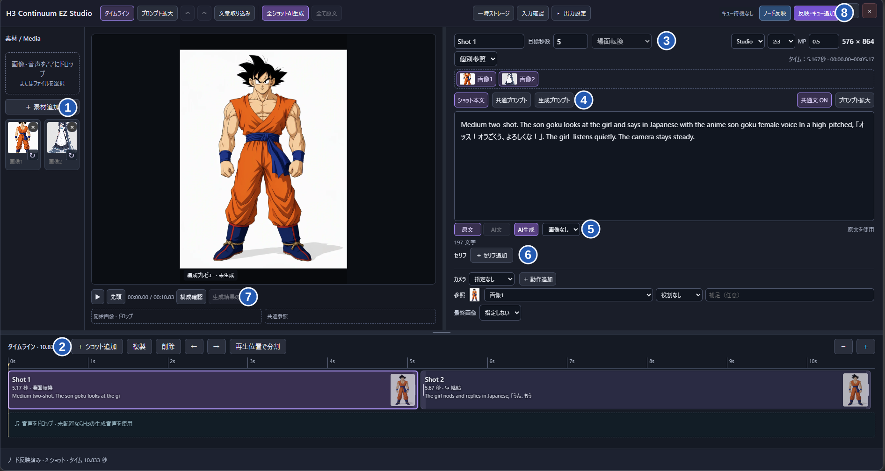

[日本語](README_JA.md) · [v0.10.1 release](https://github.com/ukr8b3g-cmyk/ComfyUI-H3-Continuum-EZ/releases/tag/v0.10.1) · [ZIP](https://github.com/ukr8b3g-cmyk/ComfyUI-H3-Continuum-EZ/releases/download/v0.10.1/ComfyUI-H3-Continuum-EZ-v0.10.1.zip) · [Workflow](https://github.com/ukr8b3g-cmyk/ComfyUI-H3-Continuum-EZ/releases/download/v0.10.1/H3_Continuum_EZ_Studio.json)

# H3 Continuum EZ Studio

An interactive ComfyUI timeline powered by the [H3 Continuum](https://github.com/ukr8b3g-cmyk/ComfyUI-H3-Continuum) continuation engine. Arrange media, edit each shot, and export a video with audio. The engine splits long shots into internal parts and carries the scene across them.

## Get started

1. Extract the [release ZIP](https://github.com/ukr8b3g-cmyk/ComfyUI-H3-Continuum-EZ/releases/download/v0.10.1/ComfyUI-H3-Continuum-EZ-v0.10.1.zip) and place `ComfyUI-H3-Continuum-EZ` in `ComfyUI/custom_nodes/`. For a Git install, run `git clone https://github.com/ukr8b3g-cmyk/ComfyUI-H3-Continuum-EZ.git` from `custom_nodes`. Update a Git install with `git pull --ff-only`. Restart ComfyUI and refresh the browser after installing or updating.
2. Drag [H3_Continuum_EZ_Studio.json](https://github.com/ukr8b3g-cmyk/ComfyUI-H3-Continuum-EZ/releases/download/v0.10.1/H3_Continuum_EZ_Studio.json) into ComfyUI. The [same template](examples/H3_Continuum_EZ_Studio.json) is in the repository.
3. Install the models below and check their file selections on the subgraph. Open **Timeline Studio** on the H3 Continuum EZ Timeline node. The template starts with two sample shots set in a garden.

## Studio walkthrough

| No. | What to do |
| --- | --- |
| ① Media | Click **Add Media** or drop images and audio. Put images reused across shots in **Shared References** below the preview. The screenshot shows example media. |
| ② Timeline | Select, add, reorder or split shots. Drag a shot edge to set its duration. Place imported audio on the track below. |
| ③ Shot settings | Set duration, cut or continuation, reference images and output size. The displayed time follows H3’s frame grid. |
| ④ Prompts | Write the action in **Shot Prompt** and shared details in **Common Prompt**. Use **Common text on/off** for the selected shot. **Generation Prompt** shows what is sent to the video model. |
| ⑤ AI text | Click **Generate AI** in the field you are editing. Shot AI receives the shot text without common text. Generate common text from its own tab. **Generate All Shots** processes only shot text. Choose **Original** or **AI Text** to switch sources. |
| ⑥ Dialogue and direction | Add dialogue with an optional speaker and start time. Set the camera, action and reference roles, then choose an optional **End image**. |
| ⑦ Preview | Check your media layout before generation. After exporting, switch to the generated video to review it. |
| ⑧ Apply and generate | **Apply to Node** saves the draft to the workflow, which you can then save in ComfyUI. **Apply and Queue** starts the video job. This template saves to `output/video/`. |

The P-H3 prompt upsampler is optional. Without it, keep **Original** selected and generate video with the existing wiring. **Generate AI** creates and selects AI text; it does not start a video job. You can edit the AI text or switch back to **Original** before generating video.

## Template models

The template uses a subgraph saved in ComfyUI 0.44.0. Use a ComfyUI build with MiniMax H3 support. The ZIP contains the workflow and node code. Download the models separately and bring your own reference images.

| Purpose | Subgraph field | Download | Under `ComfyUI/models/` |
| --- | --- | --- | --- |
| H3 REF2VA | `unet_name` | [minimax_h3_ref2va_pruned_int8_convrot.safetensors](https://huggingface.co/Comfy-Org/MiniMax-H3/resolve/main/diffusion_models/minimax_h3_ref2va_pruned_int8_convrot.safetensors) | `diffusion_models/` |
| H3 text encoder | `clip_name` | [qwen3vl_32b_minimax_h3_nvfp4_awq.safetensors](https://huggingface.co/Comfy-Org/MiniMax-H3/resolve/main/text_encoders/qwen3vl_32b_minimax_h3_nvfp4_awq.safetensors) | `text_encoders/` |
| P-H3 prompt upsampler | `clip_name_1` | [p-h3-image_prompt_upsampler_w4a8.safetensors](https://huggingface.co/PrunaAI/p-h3-image-comfy/resolve/main/text_encoders/p-h3-image_prompt_upsampler_w4a8.safetensors) | `text_encoders/` |
| Video VAE | `vae_name` | [minimax_h3_video_vae_int8_convrot.safetensors](https://huggingface.co/Comfy-Org/MiniMax-H3/resolve/main/vae/minimax_h3_video_vae_int8_convrot.safetensors) | `vae/` |
| Pika Flex REF2VA LoRA | `lora_name_1` | [pika_h3_flex_ref2va_v1_bf16.safetensors](https://huggingface.co/Comfy-Org/MiniMax-H3/resolve/main/loras/pika_h3_flex_ref2va_v1_bf16.safetensors) | `loras/` |
| Audio VAE | `vae_name_1` | [minimax_h3_audio_vae_fp32.safetensors](https://huggingface.co/Comfy-Org/MiniMax-H3/resolve/main/vae/minimax_h3_audio_vae_fp32.safetensors) | `vae/` |

If you use a shared model library or a subfolder such as `minimax/`, select the installed filenames on the subgraph. The template uses REF2VA, Pika Flex at strength 1.0, LCM with six manual steps, PyTorch Attention and portrait 2:3 at 0.5 MP. The `clip_name_1` model powers the optional AI text controls.

Use **Output Settings** to tune long-shot splitting or switch to progressive video export for lower memory use. Imported audio is used as the soundtrack when present. For chunk regeneration, resume or Second Pass, use [H3 Continuum](https://github.com/ukr8b3g-cmyk/ComfyUI-H3-Continuum).

See the [prompt guide](docs/EASY_PROMPTS_EN.md) for more examples. AI text is an experimental adaptation for video prompts. Review the result before generating.
