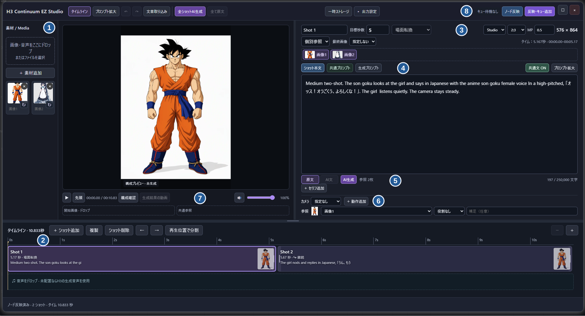

[English](README.md) · [v0.12.0 リリース](https://github.com/ukr8b3g-cmyk/ComfyUI-H3-Continuum-EZ/releases/tag/v0.12.0) · [配布ZIP](https://github.com/ukr8b3g-cmyk/ComfyUI-H3-Continuum-EZ/releases/download/v0.12.0/ComfyUI-H3-Continuum-EZ-v0.12.0.zip) · [ワークフロー](https://github.com/ukr8b3g-cmyk/ComfyUI-H3-Continuum-EZ/releases/download/v0.12.0/H3_Continuum_EZ_Studio.json)

# H3 Continuum EZ Studio

[H3 Continuum](https://github.com/ukr8b3g-cmyk/ComfyUI-H3-Continuum) の継続生成エンジンを使う、ComfyUI用のタイムラインです。素材を置き、ショットごとに動きと尺を決め、音声付き動画に書き出せます。長いショットの区間分割と継続は内部で処理します。

## はじめに

1. [配布ZIP](https://github.com/ukr8b3g-cmyk/ComfyUI-H3-Continuum-EZ/releases/download/v0.12.0/ComfyUI-H3-Continuum-EZ-v0.12.0.zip) を展開し、`ComfyUI-H3-Continuum-EZ` フォルダーを `ComfyUI/custom_nodes/` に置きます。Gitから入れる場合は `custom_nodes` で `git clone https://github.com/ukr8b3g-cmyk/ComfyUI-H3-Continuum-EZ.git` を実行します。既存のGit導入版は `git pull --ff-only` で更新できます。導入・更新後はComfyUIを再起動し、ブラウザーを更新します。
2. [H3_Continuum_EZ_Studio.json](https://github.com/ukr8b3g-cmyk/ComfyUI-H3-Continuum-EZ/releases/download/v0.12.0/H3_Continuum_EZ_Studio.json) をComfyUIへドラッグします。[同じテンプレートのソース](examples/H3_Continuum_EZ_Studio.json)もリポジトリ内にあります。
3. 下のモデル表に沿ってモデルを入れ、サブグラフ上のファイル名を確認します。「H3 Continuum EZ Timeline」の **タイムラインStudio** を開き、素材を追加します。テンプレートには庭を舞台にした2ショットの例文が入っています。

## 画面と操作順

| 番号 | 操作 |
| --- | --- |
| ① 素材 | **素材追加** または画像・音声のドロップで素材一覧へ登録します。画像を選択ショットの参照へ追加して使います。画面内の素材はユーザー提供の操作例です。 |
| ② タイムライン・音声 | ショットの選択・追加・複製・削除・並べ替え・分割。端のドラッグで秒数を調整できます。音声は素材一覧から下段へドラッグし、配置したクリップを選んで編集・削除します。 |
| ③ ショット・参照・サイズ | 選択ショットの **目標秒数** と **場面転換／継続** を設定。共通参照か個別参照を選び、使う画像をクリックします。**最終画像** もこの行で指定。比率・MPは動画全体の出力サイズ、**タイム** はH3のフレーム単位に合わせた時間です。 |
| ④ プロンプト | **ショット本文** は選択場面、**共通プロンプト** は全体で使う設定です。**共通文 ON／OFF** で選択ショットへの合成を切り替えます。**生成プロンプト** で動画モデルへ送る合成後の文章を確認できます。 |
| ⑤ AI文章 | 本文のすぐ下にある **AI生成** で文章を作成。**原文／AI文** で動画生成に使う文章を選び、両方の文章は保持します。ショットAIには画像・秒数・サイズを自動入力し、共通文は分離。上部の **全ショットAI生成** はショット本文だけを処理します。 |
| ⑥ セリフ・演出 | **セリフ追加** で話者・内容・任意の開始秒を指定します。その下で **カメラ**、動作追加、参照画像の役割を設定。モデルへの文章による指示であり、動きや発話時刻の厳密な制御ではありません。 |
| ⑦ プレビュー | 生成前は **構成確認**、書き出し後は **生成結果の動画** で確認します。再生・シークはタイムラインと連動。ミュートと音量はプレビュー専用です。下部で **開始画像** と **共通参照** を設定し、ショット側を共通参照にすると継承します。 |
| ⑧ 反映・生成 | **ノード反映** は編集をワークフローへ戻す操作で、生成は開始しません。**反映・キュー追加** で動画生成を開始。編集を残すにはComfyUI側でワークフローを保存します。**出力設定** は出力と自動分割、**一時ストレージ** はサーバーの作業用保存先を管理します。 |

P-H3アップサンプラーはAI文章生成用の任意モデルです。未導入でも、配線を変えずに **原文** で動画を生成できます。**AI生成** は文章を作成してAI文へ切り替える操作です。動画の実行前に内容を編集したり、**原文** に戻したりできます。

ショットのAI生成には、そのショットで有効な参照画像・開始画像・最終画像と、秒数・アスペクト比を自動で渡します。共通文は混ぜません。共通プロンプトのAI生成には共通文と共通参照だけを使います。**AI生成** の横に送信する画像の枚数を表示し、詳細はマウスオーバーで確認できます。画像の選択操作や追加設定は不要です。AI解析用の画像は総画素数に上限を設けて縮小し、元画像は変更しません。原文・参照画像・秒数・出力サイズを変更すると、保存済みAI文は再生成が必要になります。

## テンプレートのモデル

**最初はFastH3 OmniRefの8ステップ版を使ってください。** メインのテンプレートは [H3_Continuum_EZ_Studio.json](examples/H3_Continuum_EZ_Studio.json) です。配布ZIPにも同梱しています。モデルと素材画像は含みません。

従来の **REF2VA＋Pika Flex版** は[オプションのテンプレート](examples/H3_Continuum_EZ_Studio_REF2VA_Optional.json)です。それぞれのモデル配線・サンプラー・シード設定を保ったまま別々に使います。オプションには [minimax_h3_ref2va_pruned_int8_convrot.safetensors](https://huggingface.co/Comfy-Org/MiniMax-H3/resolve/main/diffusion_models/minimax_h3_ref2va_pruned_int8_convrot.safetensors) を `models/diffusion_models/`、[pika_h3_flex_ref2va_v1_bf16.safetensors](https://huggingface.co/Comfy-Org/MiniMax-H3/resolve/main/loras/pika_h3_flex_ref2va_v1_bf16.safetensors) を `models/loras/` に配置します。H3テキストエンコーダー・映像／音声VAE・任意のAI文章モデルは下表と共通です。Pika LoRAはREF2VAオプション用であり、メインのFastH3版には追加しません。

### 必要環境

| 項目 | 必要条件・動作確認した構成 |
| --- | --- |
| ComfyUI | このサブグラフ全体は **v0.44.0以降を推奨**。確認環境はv0.44.0。PDD内蔵モデルの読込対応は **v0.42.0から** で、それ以前ではこのモデルを正しく読み込めません。 |
| フロントエンド | ComfyUIに付属する対応版を使用。保存・確認した版は **1.57.6**。 |
| Python | **3.13推奨**、確認済みは **3.13.12**。モデル自体がPython 3.13専用という意味ではありません。他のPython構成ではこのテンプレートを検証していません。 |
| NVIDIA用PyTorch | **CUDA 13.0以上のビルド（`cu130`以上）** を使用。確認済みは **2.14.1+cu130**。CUDA Toolkitだけを入れてもPyTorchのCUDAは切り替わりません。 |
| Comfy Kitchen | ComfyUIの依存関係で指定された版を使用。確認済みは **0.2.40**。配布CUDA wheelにはCUDA Runtime 13.0以上・NVIDIAドライバー **r580以上** が必要です。 |
| 既定のテキストエンコーダー | 配布元の[Comfy-Org](https://huggingface.co/Comfy-Org/MiniMax-H3)は、この **NVFP4 AWQエンコーダー自体はBlackwell専用ではない** と明記しています。ネイティブNVFP4演算の高速化には対応GPU・カーネルが必要です。代替として [BF16](https://huggingface.co/FastVideo/FastH3-Omni-Comfy/resolve/main/text_encoders/qwen3vl_32b_minimax_h3_bf16.safetensors) または [INT8 ConvRot](https://huggingface.co/FastVideo/FastH3-Omni-Comfy/resolve/main/text_encoders/qwen3vl_32b_minimax_h3_int8_convrot.safetensors) のテキストエンコーダーをサブグラフで選択します。 |
| 動画・音声出力 | ComfyUIの依存関係に含まれる **PyAV 17以上**。確認済みは **19.0.2**。 |

モデル読込の対応時期は[ComfyUI v0.42.0のPDD対応](https://github.com/Comfy-Org/ComfyUI/releases/tag/v0.42.0)、Python・CUDAは[ComfyUIの導入説明](https://github.com/Comfy-Org/ComfyUI#manual-install-windows-linux)と[Comfy Kitchenの必要条件](https://github.com/Comfy-Org/comfy-kitchen#requirements)、モデル構成・NVFP4は[FastH3公式モデルカード](https://huggingface.co/FastVideo/FastH3-Omni-Comfy)を確認しています。旧版のComfyUIや別GPUでの動作確認はしていません。

| 用途 | サブグラフの欄 | ダウンロード | `ComfyUI/models/` 以下 |
| --- | --- | --- | --- |
| FastH3 OmniRef 拡散モデル | `unet_name` | [fasth3_omniref_8step_pruned_int8_convrot.safetensors](https://huggingface.co/FastVideo/FastH3-Omni-Comfy/resolve/main/diffusion_models/fasth3_omniref_8step_pruned_int8_convrot.safetensors) | `diffusion_models/` |
| H3 テキストエンコーダー | `clip_name` | [qwen3vl_32b_minimax_h3_nvfp4_awq.safetensors](https://huggingface.co/Comfy-Org/MiniMax-H3/resolve/main/text_encoders/qwen3vl_32b_minimax_h3_nvfp4_awq.safetensors) | `text_encoders/` |
| AI文章用 P-H3 アップサンプラー | `clip_name_1` | [p-h3-image_prompt_upsampler_w4a8.safetensors](https://huggingface.co/PrunaAI/p-h3-image-comfy/resolve/main/text_encoders/p-h3-image_prompt_upsampler_w4a8.safetensors) | `text_encoders/` |
| 映像VAE | `vae_name` | [minimax_h3_video_vae_int8_convrot.safetensors](https://huggingface.co/Comfy-Org/MiniMax-H3/resolve/main/vae/minimax_h3_video_vae_int8_convrot.safetensors) | `vae/` |
| 音声VAE | `vae_name_1` | [minimax_h3_audio_vae_fp32.safetensors](https://huggingface.co/Comfy-Org/MiniMax-H3/resolve/main/vae/minimax_h3_audio_vae_fp32.safetensors) | `vae/` |

Stability Matrixの共有フォルダーや `minimax/` などを使う場合は、サブグラフ上で実際のファイルを選び直します。FastH3テンプレートは、提供版の **Euler／simple／8ステップ、映像Shift 12／音声Shift 3、Comfy Kitchen attention、VSA 10%・全区間、縦長2:3・0.5 MP** を維持しています。従来のREF2VA版に使う **Pika LoRAは追加しません**。テキストエンコーダーとVAEは共通のH3用ですが、内部のSampling・Attention設定も異なるため、旧版で拡散モデル名だけを変えても同じ構成にはなりません。AI文章生成には `clip_name_1` のモデルを使います。

長いショットの分割やメモリーを抑える動画出力は **出力設定** で選べます。配置した音声がある場合はその音声を使い、ない場合はH3の生成音声を使います。チャンクの再生成・途中再開・Second Passを使う制作には通常版 [H3 Continuum](https://github.com/ukr8b3g-cmyk/ComfyUI-H3-Continuum) を利用してください。

出力形式は **自動／動画保存／動画＋画像** です。どちらの動画出力も音声付きで保存し、画像処理が必要な配線では画像データも自動で出力します。手動での配線切替は不要です。自動分割の初期値は **7.5秒**。例えば15秒のショットは2区間で生成します。入力した7.5は保持し、実際の区間時間だけをH3のフレーム単位に調整します。

## プロジェクト

1. **プロジェクト → 新規プロジェクト** で空のタイムラインを作成。
2. **プロジェクト → プロジェクト保存** で現在の編集をPCへ保存。
3. **プロジェクト → プロジェクト読込** で復元後、**ノード反映** または **反映・キュー追加** で使用。

Studio上部の **プロジェクト** から **新規プロジェクト／プロジェクト読込／プロジェクト保存** を選べます。`.h3ez.json` にショット・原文／AI文・素材参照・音声編集・Studioの出力設定を保存。未保存の編集があれば置換前に確認し、置換後も「元に戻す」で復元できます。素材本体はComfyUIの入力フォルダーに置いたままで、ファイルには含みません。モデル配線・外部STRINGノード・生成済み動画はワークフロー／サーバー側の情報です。読込後は **ノード反映** または **反映・キュー追加** を使います。[プロジェクト操作の詳細](docs/PROJECT_FILES_JA.md)。

## 音声編集

**素材追加** または素材欄へのドロップで読み込み、素材一覧から音声トラックへドラッグします。素材は元の長さを保持し、1分の音声は1分のクリップとして配置します。動画ファイルも音声だけ取り込めます。映像はタイムラインへ追加しません。

音声クリップを選択すると、移動・トリム・分割・複製・削除ができます。Delete／Backspaceで選択した配置を削除しても素材は残り、**元に戻す** で復元できます。音声が映像より長い場合も全体を表示します。生成前に **映像尺合わせ** で最後のショットを延ばします。音声を勝手に短縮したり、ショットを無断で延ばしたりしません。

プレーヤーのミュートと音量はプレビュー専用です。音声クリップの音量は、生成ガイドと書き出す音声に反映します。音声は重ね合わせのない1トラックです。

詳しい記入例は [プロンプトガイド](docs/EASY_PROMPTS_JA.md) を参照してください。AI文は動画向けに調整した実験機能です。内容を確認してから使ってください。
